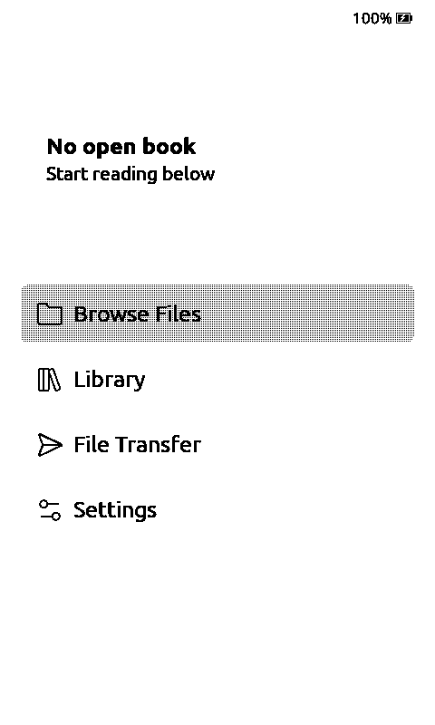

# BOOX Picco / Onyx Picco

The current CrossMux local rehearsal uses Reader
`98da17829cb3c8afbc50af491c81d440bbfd15b9`, SDK upstream
`28edea3a768f9fd2dd45300ff9fca02ae7735b36` with retained fork changes
(exported SDK source tree `f32d5ecaec2c309f02a4022fcede67a03b24ede8`), and
Simulator upstream `a4397d28fad79066d598c16f7ab9c13d341710cc`.
The reviewed SDK identifies the touch controller as Parade TMA525C
(`TouchController::Tma525c`); the original simulator used the `PiccoCst` name.
The current [SDK board profile](https://github.com/Free-Ink/freeink-sdk/blob/28edea3a768f9fd2dd45300ff9fca02ae7735b36/libs/hardware/BoardConfig/include/BoardConfig.h)
provides the shared hardware contract. Local integration and physical acceptance
are recorded separately from the historical upstream checks below.

The original profile follows the `picco` environment merged in
[CrossPoint PR 3947](https://github.com/crosspoint-reader/crosspoint-reader/pull/3947),
firmware `261726f617c3fcd78cb75949ee3b68ece6c23c03` and its pinned FreeInk SDK
`25cd36c7c28192991f11ba99c1f520d19ff12fa5`.
The original source contract is the SDK's
[PICCO board profile](https://github.com/Free-Ink/freeink-sdk/blob/25cd36c7c28192991f11ba99c1f520d19ff12fa5/libs/hardware/BoardConfig/include/BoardConfig.h#L1692).
Some SDK comments retain earlier bring-up limitations; the current initializer,
capability helpers and driver implementation define the host profile below.

## Profile and controls

- Native panel frame: 800x480, 48,000 bytes at one bit per pixel. Portrait UI is
  480x800; landscape is 800x480. Default viewable insets match the SDK.
- The SDK reports `SSD1677`, variant 0, and probes SSD1677/SSD2677 panels inside
  its driver. The host preserves that nominal profile; it does not probe or
  simulate the panel variants, waveforms or refresh timing.
- `Tma525c` touch uses the shared orientation-aware mouse/tap/swipe path. There
  is no capacitive Home key. H and Metalio cover Prev/Next have no effect.
- Up/Down map to the SDK's GPIO21/GPIO9 buttons; P maps to Power. Return exposes
  the SDK's GPIO5 Confirm input, whose physical role is still marked unconfirmed
  in that profile. Escape and Left/Right are disabled because those inputs are
  unassigned. The simulator does not establish the physical GPIO5 mapping.
- T changes the slide-switch position. `SWITCH_ON` and `SWITCH_OFF` scripted
  events select a position explicitly. `CROSSPOINT_SIM_SLIDE_SWITCH=on` sets the
  boot position; the default is off. The position persists across the host's
  sleep/relaunch, including changes while asleep; moving it does not itself wake
  the device. Firmware owns the selected binding: frontlight, night mode or
  touch controls. The host does not write those settings directly.
- Warm/cool I2C frontlight state is available through `HalFrontlight`, not PWM.
  RTC availability uses host time; the tilt sensor reports availability, as on
  the SDK profile, but this shim does not generate physical tilt measurements.
- Picco is an S3 profile, not a C3 Xteink device, and has no haptic capability.
  The sample enables the existing `BOARD_HAS_PSRAM` host mock. Allocations and
  heap statistics are desktop behavior, not the physical 8 MB PSRAM or 16 MB flash.

Use `simulator_picco` from either sample PlatformIO configuration. It defines
`SIMULATOR_DEVICE_PICCO` and normalizes the SDK device flags so Picco-specific
firmware UI runs, including the slide-switch setting. The consuming firmware
owns update availability. Xteink controller overrides are rejected for this profile.

```sh
pio run -e simulator_picco
CROSSPOINT_SIM_SLIDE_SWITCH=on \
CROSSPOINT_SIM_INPUT_SCRIPT='2500:SWITCH_OFF;3500:SWITCH_ON;4500:QUIT' \
  .pio/build/simulator_picco/program
```

## Power compatibility

Current Picco firmware adds `holdWhileUsbPowered()` and the
`startDeepSleep(gpio, wakeOnHeldButton)` argument. The host accepts both APIs.
A held-button wake relaunches immediately; ordinary sleep uses the existing
input-driven relaunch. There is no charger/USB-unplug model: the USB-powered
charge hold returns false without reporting a synthetic charging status, so
the established host sleep path remains available. Charger polling, its sleep
status strip, I2C shutdown and electrical wake behavior need hardware testing.

## Verification

```sh
python3 tests/check-profile-selection.py
sh tests/run-picco.sh
sh tests/run-eego.sh
sh tests/run-metalio.sh
```

The Picco test runs with and without `NDEBUG`, checks capabilities and input
availability, frontlight state, RTC/tilt availability, switch keyboard/script
events, and edge taps/swipes in all four orientations. It changes the switch
while the host sleeps and checks the retained position after a real process
relaunch. The same runner checks caller-owned static mutex storage and mutual
exclusion between threads; current firmware needs that API for GIF generation.
EEGO and Metalio are controls for shared input/frontlight behavior.

### Historical upstream application checks

On Intel macOS, the original firmware `261726f6` and SDK `25cd36c7` built with both
`pio run -e simulator_picco` and the default X4 `pio run -e simulator`.
The real application opened a generated two-spine ALPHA EPUB, turned a page
and returned Home in all four orientations. The rotation runs used normalized
`SWIPE:0.5,0.98,0.5,0.5` coordinates so their scheduled gestures do not depend
on the initial boot orientation.

Both switch positions were checked against the saved firmware setting for all
three bindings: `frontlightOn`, `screenInverted` and `touchReaderControls`.
A sleep/wake application run booted twice and restored the switch's off
position after it was changed while asleep. The X4 control reached Home without
exposing a switch. [Recorded inputs and outcomes](picco-verification.json).

The native power test reports unused-private-field warnings in the existing
host power shim. The full application also retains the existing miniz macro
redefinition warning; these checks do not claim warning-free builds.




These are simulator checks. Physical touch protocol/calibration, panel probing,
grayscale quality, PSRAM pressure, SDMMC, USB-MSC and power behavior are not
validated by this profile.
